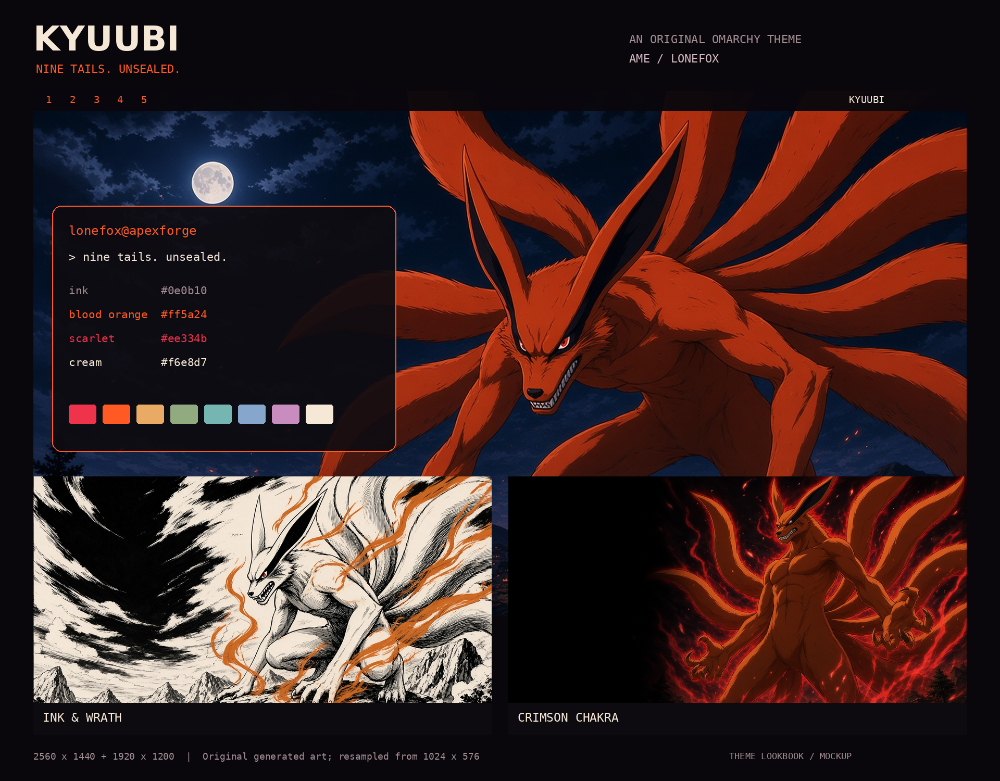

# Kyuubi

Nine tails. Unsealed.

An original dark [Omarchy](https://omarchy.org) theme inspired by Kurama, the Nine-Tails, from Naruto. Deep plum-ink blacks, blood-orange focus, scarlet accents, and pale cream text.

This is unofficial fan-made work. Naruto and Kurama belong to their respective rights holders; this theme is not official artwork or an endorsed product.



## Install

```sh
omarchy theme install https://github.com/L0nE-F0x/omarchy-kyuubi-theme.git
```

Or open the Omarchy menu and choose Install → Style → Theme, then paste that URL.

## Palette

| Role | Hex |
| --- | --- |
| Background | `#0e0b10` |
| Accent / blood orange | `#ff5a24` |
| Scarlet | `#ee334b` |
| Text / cream | `#f6e8d7` |

`colors.toml` is the source of truth. Omarchy generates app configs from it, including the orange-to-scarlet window border.

## Wallpapers

Original generated artwork — not official screenshots or manga panels — at 3840×2160:

1. **Nine Tails Rising** — a colossal red-orange Kurama over a moonlit village
2. **Ink & Wrath** — black-and-white crosshatched manga styling with orange chakra spot color
3. **Crimson Chakra** — an upright Kurama with a scarlet bijuu aura

Cycle backgrounds with Super+Ctrl+W, or `omarchy theme bg next`.

## Unlock

`unlock.png` and `preview-unlock.png` are included for Appearance → Unlock.

## License

Theme files are MIT licensed (see [LICENSE](LICENSE)).

Backgrounds are original generated fan art. Naruto and Kurama remain the property of their rights holders.
