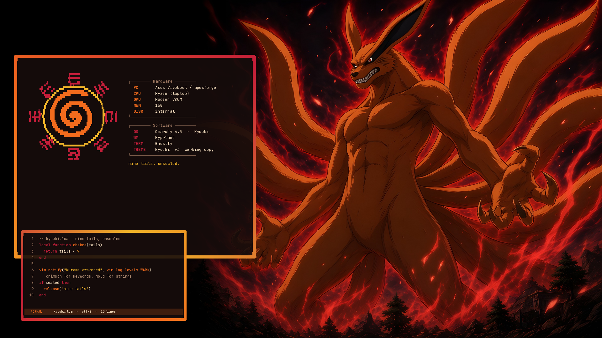

# Kyuubi

Nine tails. Unsealed.

An engineered dark [Omarchy](https://omarchy.org) 4.5 theme inspired by Kurama,
the Nine-Tails: charred seal-black surfaces, Kurama chakra orange (`#F26B1D`),
bijuu crimson (`#F04A58`), ember gold (`#F0B429`), Konoha sage (`#92B46E`),
moonlit mist (`#78AEBB`), and warm parchment ink (`#FCE6C8`).



## Palette & Accessibility

Every foreground, muted, and semantic syntax color in [`colors.toml`](colors.toml)
is tuned for **WCAG AA (>= 4.5:1)** contrast against both the main `#160C0B`
surface and elevated `#261411` cards.

| Role | Hex | Notes |
| --- | --- | --- |
| Deeper / Bar Black | `#090505` / `#100807` | Scrims, bar, splits |
| Seal-Black Canvas | `#160C0B` | Primary terminal & editor background |
| Elevated Card | `#261411` | Popups, tooltips, cursorline |
| Blood-Ember Selection | `#521D15` | High-contrast selection wash |
| Chakra Orange | `#F26B1D` | Primary accent, cursor, functions |
| Bijuu Crimson | `#F04A58` | Keywords, alerts, active borders |
| Ember Gold | `#F0B429` | Types, hover highlights, search hits |
| Parchment Text | `#FCE6C8` | Primary ink (`15.8:1` contrast) |

## What's Included

- **Quickshell Chrome (`shell.toml`)**: Translucent seal-black bar (`0.84`),
  distinct 4-state `[controls]` interaction language (idle parchment/bronze,
  ember-gold hover, chakra-orange keyboard focus, glowing orange selected),
  crimson urgent alerts, and a glass fire-seal `[lock]` input.
- **Hyprland (`hyprland.lua`)**: Seamless 5-stop rotating chakra-orange → crimson →
  gold `borderangle` loop (`2px`), themed `groupbar` tabs, and a soft warm ember
  window shadow.
- **Neovim (`neovim.lua`)**: Tuned `aether.nvim` v3 `on_highlights` with
  crimson keywords, chakra-orange functions/calls, ember-gold types, sage strings,
  mist parameters, and custom float/picker/diagnostic borders.
- **Terminals (`ghostty.conf`, `kitty.conf`, `alacritty.toml`, `foot.ini`)**:
  Unified 16-color palette (`7` light parchment vs `15` bright bone), chakra-orange
  cursors, preserved selection foregrounds (`cell-foreground` in Ghostty),
  gold/orange search highlights, split dividers, and `0.90` translucency.
- **btop (`btop.theme`)**: Semantic thermal scale — free/idle bars recede into
  warm ash while active CPU, memory, and downloads heat from umber → orange →
  bright gold; uploads use cool mist steel; temperature ramps sage → gold → crimson.
- **Editors & Apps (`obsidian.css`, `helix.toml`, `chromium.theme`, `keyboard.rgb`, `icons.theme`)**:
  Hand-crafted Kyuubi stylesheets for Obsidian and Helix alongside Omarchy's
  generated configs (VS Code, Claude Code, Hermes, Pi, T3 Code, Fcitx5).
  Uses `Yaru-ember` locally (if publishing upstream without local icon assets,
  use `Yaru-red-dark`).
- **Plymouth / SDDM Unlock (`unlock.png`, `preview-unlock.png`)**:
  True transparent-background RGBA Eight Trigrams Seal emblem (`760×438`) sized
  so Plymouth's password box stays centered cleanly on both 1080p and 1440p screens.
- **About Branding (`branding/`, `fastfetch/kyuubi-about.jsonc`)**:
  Three 54×26 quadrant-block marks — Eight Trigrams Seal (`about.txt`), Kurama Crest
  (`about-fox.txt`), and Konoha Leaf (`about-leaf.txt`) — plus a fixed Fastfetch
  config preserving all Omarchy hardware, software, color-dot swatch, and age modules.
- **Optional Operator Terminal (`scripts/kyuubi-terminal`, `extras/`)**:
  Launch a scoped Ghostty or Foot session with the Kyuubi Starship prompt and
  optional static `chakra-ember.glsl` shader without modifying global configs:

```sh
cd ~/.config/omarchy/themes/kyuubi
./scripts/kyuubi-terminal --ember
```

## Wallpaper

[`backgrounds/01-crimson-chakra.jpg`](backgrounds/01-crimson-chakra.jpg) (`3840×2160`) — preserved untouched.

## Validation

```sh
python3 -m unittest discover -s ~/.config/omarchy/themes/kyuubi/tests -v
```

## License

Theme configuration files are MIT licensed (see [LICENSE](LICENSE)).
Background artwork is unofficial fan art; Naruto and Kurama belong to their respective rights holders.
